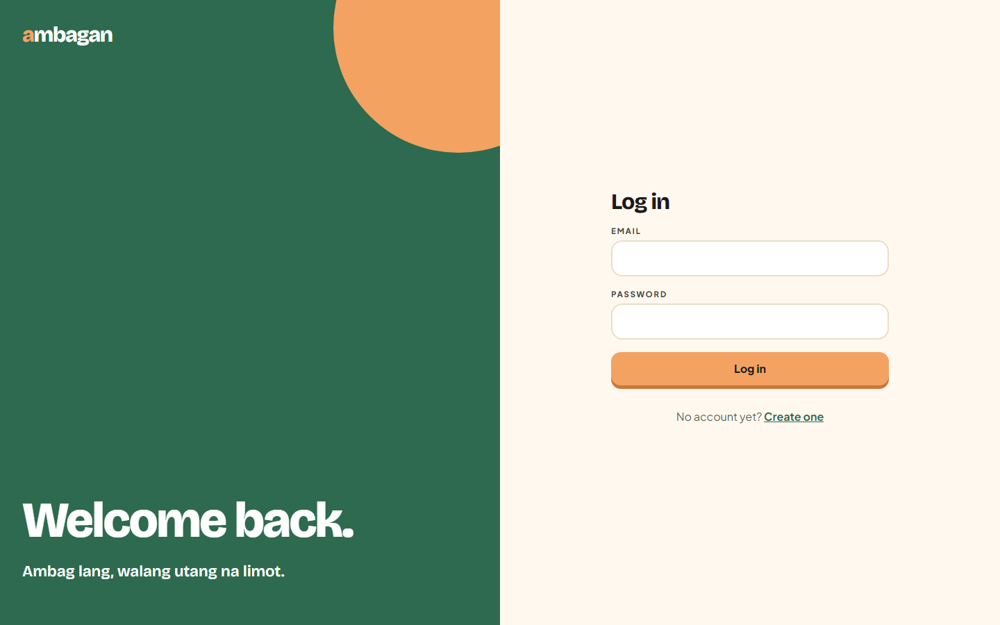
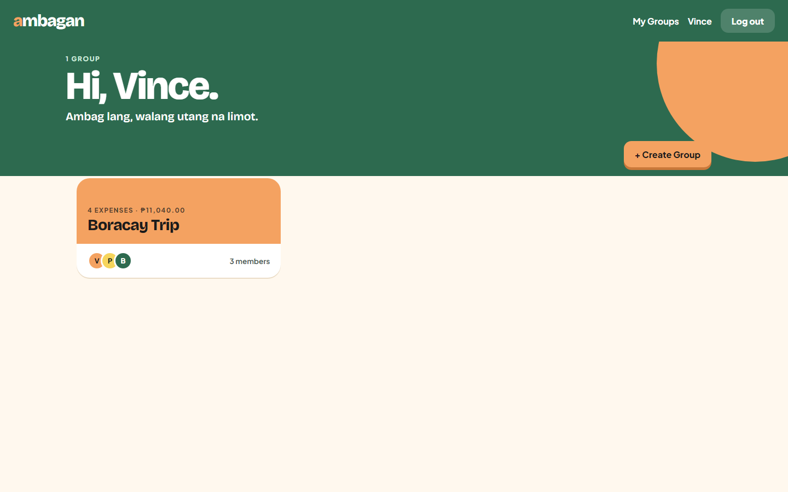
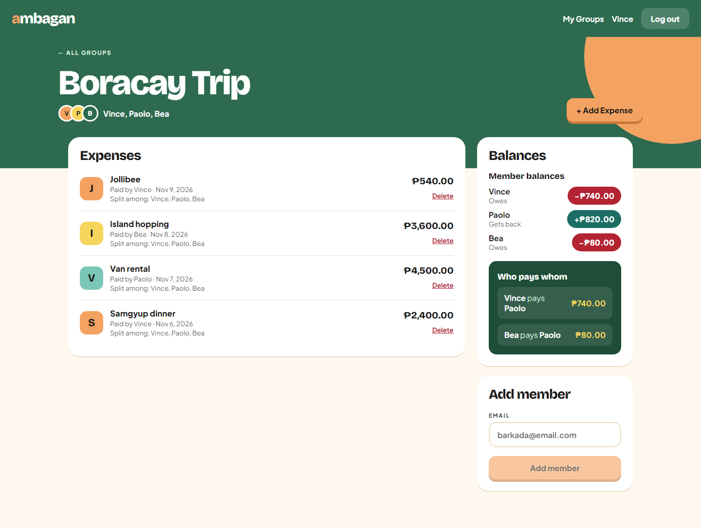
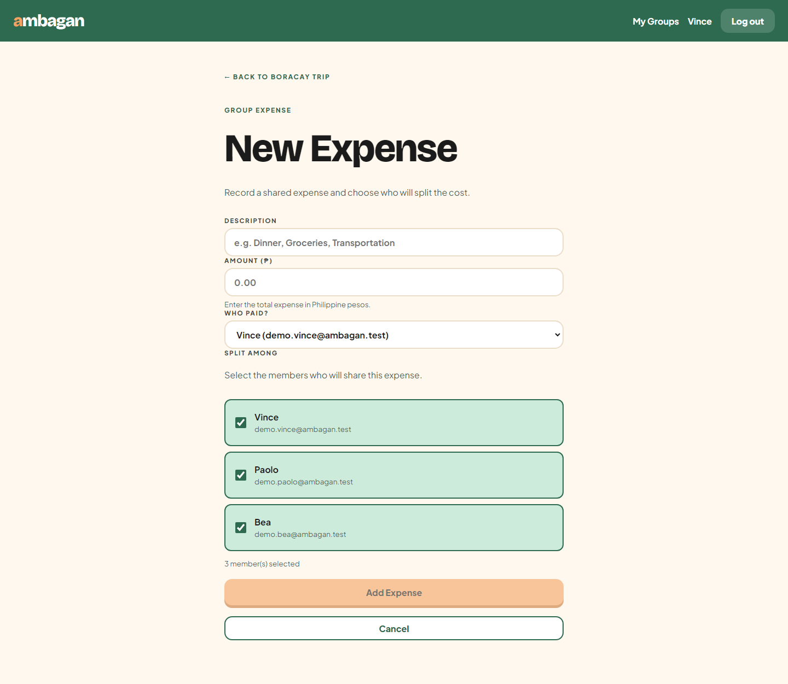
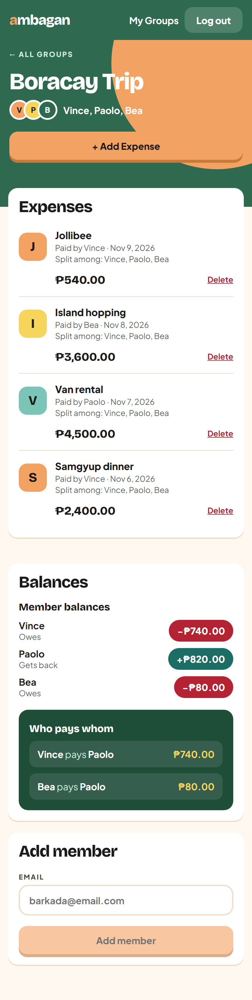
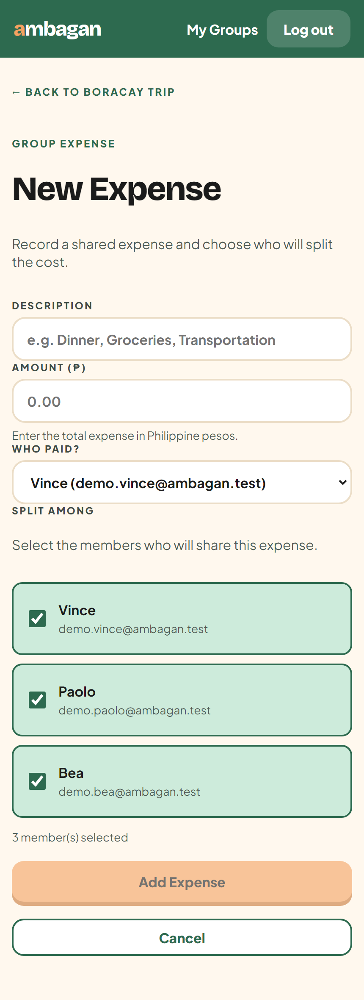

# ambagan 🪙

> Ambag lang, walang utang na limot.

Ambagan is a MERN expense splitter for barkadas. Create a group, log shared expenses, and see who owes whom. The name comes from the Filipino word *ambagan*, where everyone chips in.

**Stack:** MongoDB Atlas · Express · React (Vite) · Node.js · JWT auth · bcrypt

---

## Features

- Register / log in (passwords hashed with bcrypt, JWT sessions, protected routes on both client and server)
- My Groups: list your groups (with expense count and total spent) and create new ones by member email
- Group page: members, add a member by email, expense history (newest first), live balances panel
- Add Expense: description, amount in pesos, who paid, who it is split among (equal split)
- Delete expense (balances update right away)
- Balances: net per member (teal = gets back, red = owes) plus simplified "who pays whom" transfers
- Loading, error, and empty states on every page; responsive down to phone size
- Money is stored in **centavos** (integers) to avoid floating-point errors

---

## Screenshots

### Login


### My Groups


### Group page (expenses + balances)


### Add Expense


### Mobile
| Group page | Add Expense |
| --- | --- |
|  |  |

---

## Setup

### 1. Clone and install

```bash
git clone https://github.com/BinsU01/ambagan.git
cd ambagan
cd server && npm install
cd ../client && npm install
```

### 2. Environment variables

```bash
cd server
cp .env.example .env
```

Fill in `server/.env`:

| Variable | What it is |
| --- | --- |
| `MONGO_URI` | MongoDB Atlas connection string (ask the team lead, never commit it) |
| `JWT_SECRET` | Any long random string |
| `JWT_EXPIRES_IN` | `7d` |
| `PORT` | `5000` |
| `CLIENT_URL` | `http://localhost:5173` |

### 3. Run (two terminals)

```bash
# terminal 1
cd server && npm run dev     # API on http://localhost:5000

# terminal 2
cd client && npm run dev     # app on http://localhost:5173
```

Check the API is up: http://localhost:5000/api/health

### 4. Demo data (optional)

```bash
cd server && node seed.js
```

Creates 3 demo accounts and a "Boracay Trip" group with 4 expenses. Log in with
`demo.vince@ambagan.test` / `demo1234`. Expected balances: Vince owes ₱740.00, Paolo gets back ₱820.00, Bea owes ₱80.00.

### 5. Test the balance math

```bash
cd server && npm run test:balances
```

---

## How the balances work

1. For each expense, the amount is split equally among the selected members. Leftover centavos go to the first members, so the shares always add up to the exact total.
2. A member's **net balance** = what they paid minus their share of everything.
3. The "who pays whom" list matches the biggest debtor with the biggest creditor until everyone is settled, which keeps the number of payments small.

The logic lives in `server/utils/balances.js` and is covered by `balances.test.js`.

---

## API

All routes except register/login need `Authorization: Bearer <token>`.

| Method | Route | Description |
| --- | --- | --- |
| POST | `/api/auth/register` | Create account |
| POST | `/api/auth/login` | Log in |
| GET | `/api/auth/me` | Current user |
| GET | `/api/groups` | My groups |
| POST | `/api/groups` | Create group |
| GET | `/api/groups/:id` | Group details |
| POST | `/api/groups/:id/members` | Add member by email |
| GET | `/api/groups/:groupId/expenses` | Expense history |
| POST | `/api/groups/:groupId/expenses` | Add expense |
| DELETE | `/api/groups/:groupId/expenses/:expenseId` | Delete expense |
| GET | `/api/groups/:id/balances` | Balances + transfers |

Group and expense routes check that you are logged in **and** a member of the group (`middleware/groupMember.js`).

---

## Project structure

```
server/
  config/db.js            MongoDB connection
  models/                 User, Group, Expense (Mongoose schemas + validation)
  middleware/             auth (JWT), groupMember, errorHandler
  controllers/            auth, group, expense, balance logic
  routes/                 URL -> controller
  utils/balances.js       split / net balance / settle-up math (tested)
  seed.js                 demo data
client/src/
  api/client.js           axios instance (adds token automatically)
  context/AuthContext.jsx login, register, logout, current user
  components/             Navbar, ProtectedRoute, Spinner, Avatar, ExpenseList, BalancesPanel
  pages/                  Login, Register, MyGroups, GroupPage, AddExpense
  utils/money.js          formatPeso(), toCentavos()
  styles/index.css        design tokens (colors, fonts) + shared styles
screenshots/              images used in this README
```

---

## Team

| Member | Worked on |
| --- | --- |
| Vince (`BinsU01`) | Project setup, auth, schemas, Groups feature, polish (responsive layout, loading and error states), demo data, README |
| Michael (`chael-r`) | Expenses feature (endpoints, Add Expense form, expense list, delete) and the Balances panel |
| Rodner (`rodnersantos-design`) | Balances feature |

Workflow: we split the work by feature, committed in small steps with clear messages (`feat: ...`, `fix: ...`, `polish: ...`), pulled before starting, and never committed `.env`.
